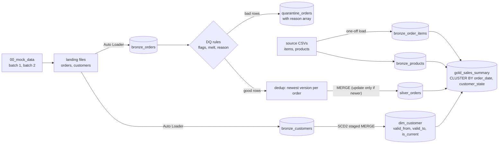

# Olist Medallion Pipeline on Databricks (compact version)

A small Bronze → Silver → Gold pipeline in PySpark and Delta Lake. It shows four things end to end: **incremental ingestion with Auto Loader**, **data quality with a quarantine table**, **CDC with Delta MERGE**, and **SCD Type 2**.

> **About the data.** The source is the public [Olist Brazilian E-Commerce dataset](https://www.kaggle.com/datasets/olistbr/brazilian-ecommerce) (static CSV files; check the dataset page for its license). The CDC batches and customer address changes are **simulated** by `00_mock_data.py`, and a few bad rows are injected on purpose, because the original data is clean and has no changes over time.

## Architecture

## Notebooks

| Notebook | What it does |
|---|---|
| `00_mock_data.py` | Simulated source system. `batch` widget: **1** = 70% of orders + bad rows + all customers; **2** = remaining 30% of orders + 1,000 status updates (CDC) + 1,000 customers who moved (SCD2). `reset` widget wipes everything. |
| `01_bronze.py` | Auto Loader for orders and customers (only new files are read each run, via checkpoints). Everything is kept as strings plus `_load_dttm` and `_file_path`. Items and products are loaded once. |
| `02_silver.py` | Orders: DQ → quarantine → dedup → MERGE. Customers: SCD2 into `dim_customer`. |
| `03_gold.py` | Sales mart by day, state and category, then verification queries. |
| `04_governance.py` | Unity Catalog governance: Liquid Clustering check + OPTIMIZE, **column masks** on `dim_customer`, **row filter** on `gold_sales_summary`. Run last. |

### Data-quality step (orders)

One boolean flag per rule, then `.melt()` turns the flags into rows, keeps the ones that are true, and collects them into an array column `reason`. Bad rows go to `quarantine_orders` **with** `reason`.

| Reason code | Meaning |
|---|---|
| `order_id_null` | key is missing |
| `order_id_invalid` | not 32 hex characters |
| `customer_id_null` | missing customer |
| `purchase_ts_invalid` | purchase time missing or not `yyyy-MM-dd HH:mm:ss` |
| `status_invalid` | not one of the 8 known statuses |
| `updated_at_invalid` | `source_updated_at` missing or invalid |

Good rows are deduplicated with one `row_number()` per `order_id` (newest `source_updated_at`, then latest load). That removes exact duplicates and old versions of the same order (CDC) in a single step, and the MERGE only updates a row when the incoming version is newer.

### SCD Type 2 (`dim_customer`)

Tracks `zip`, `city` and `state`. Changed customers are added to the merge source twice: once with a NULL key (never matches → **INSERT the new version**) and once with the real key (matches the current row → **close it** with `is_current = false` and `valid_to`). `<=>` is used so NULL comparisons are safe.

### Governance (`04_governance.py`)

| Feature | Where | What it does |
|---|---|---|
| Liquid Clustering | `silver_orders` (`order_id`), `dim_customer` (`customer_id`), `gold_sales_summary` (`order_date, customer_state`) | Keys chosen from how each table is merged / filtered. Declared at creation, no partitions to manage. |
| Column mask | `dim_customer.customer_unique_id`, `customer_zip_code_prefix` | Non-admins see a SHA-256 hash (still joinable) and `01***`. |
| Row filter | `gold_sales_summary` on `customer_state` | Admins see all rows, `sp_analysts` only state SP, everyone else none. |

Both policies are plain SQL functions using `is_member(<group>)`, attached with `ALTER TABLE ... SET MASK` / `SET ROW FILTER`.

## How to run

1. Upload the four Olist CSVs to `/Volumes/<catalog>/olist/raw/source/` (`olist_orders_dataset.csv`, `olist_customers_dataset.csv`, `olist_order_items_dataset.csv`, `olist_products_dataset.csv`).
2. Set `CATALOG` at the top of each notebook (same value in all four).
3. **First load:** in `00_mock_data` set `batch = 1` and `reset = yes`, run it, then set `reset` back to `no`. Run `01_bronze` → `02_silver` → `03_gold`.
4. **Second load:** set `batch = 2`, run `00_mock_data` (with `reset = no`), then `01_bronze` → `02_silver` → `03_gold` again.

5. **Governance:** run `04_governance` after Gold. Change `ADMIN_GROUP` to a non-existent group to see what a restricted user sees.

Requirements: Unity Catalog with Volumes and a runtime that supports Auto Loader, `try_to_timestamp`, `DataFrame.melt` and Liquid Clustering (current serverless compute or a recent DBR). If your compute rejects `CLUSTER BY`, delete that line in `03_gold.py`.

## Results

<!--
  TODO before publishing: run both batches, fill in the "Actual" column, add screenshots under
  docs/images/, then delete this comment and the "Expected" note.
-->

Facts about the source data (measured on the CSV files): 99,441 orders, 112,650 order items, 32,951 products; 775 orders have no items; 97% of orders are delivered.

**"Expected" is what the simulation is designed to produce, not a measured result.**

| Check (after both batches) | Expected | Actual |
|---|---|---|
| `quarantine_orders` rows | 20 (10 null key + 10 malformed key) | _fill in_ |
| `silver_orders` rows | 99,441 | _fill in_ |
| orders updated to `delivered` by CDC | up to 1,000 | _fill in_ |
| `dim_customer` rows where `is_current` | 99,441 | _fill in_ |
| extra closed versions in `dim_customer` | about 1,000 (a few fewer if a mover draws the old address) | _fill in_ |

Screenshots to add: quarantine reasons, a customer with two versions in `dim_customer`, `DESCRIBE DETAIL gold_sales_summary` (clustering columns), top rows of the gold table.

## Design choices and limitations

- **Bronze keeps strings.** Invalid values must reach Silver so DQ can catch and explain them instead of turning into NULL silently.
- **`dim_customer` is keyed on `customer_id`.** In Olist, `customer_id` is generated per order; the real person is `customer_unique_id` (96,096 people vs 99,441 ids). A production version would track history per person; this one keeps the project small.
- **`valid_from` is processing time**, not a business date, so you cannot yet join orders to the address valid on the order date.
- **Gold reads items and products from Bronze** and casts inline; a fuller version would add Silver tables for them.
- **Silver re-reads all of Bronze each run.** Fine for ~100K rows; for large data use Change Data Feed or a streaming read.
- **Inner joins in Gold** drop orders without items.
- **Run the pipeline as an admin / owner.** `02_silver` compares `dim_customer` addresses; a masked zip would look like a change. Re-run `04_governance` after every `03_gold` run (`CREATE OR REPLACE TABLE` drops policies).
- Policies use group membership; production would use account-level groups (`is_account_group_member`) or ABAC tags.
- No scheduling, automated tests or CI yet.
